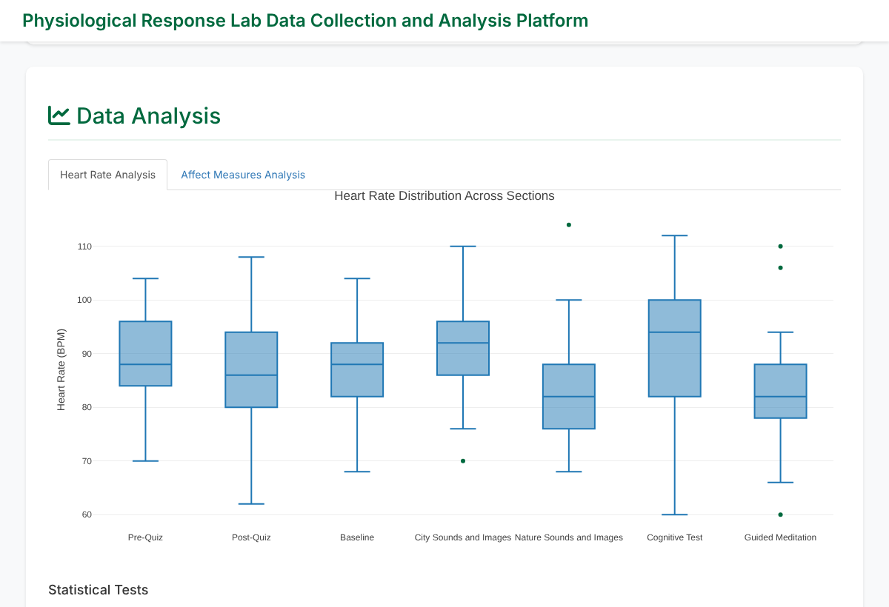
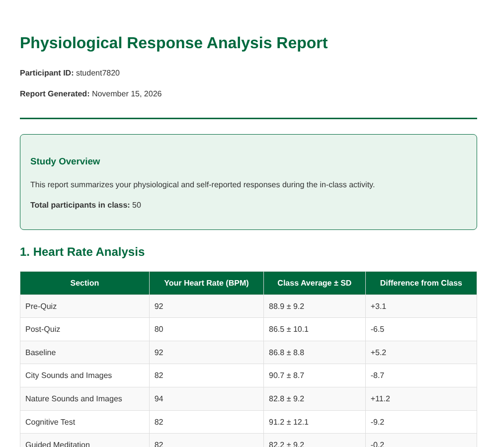

# Physiological Response Lab

A Shiny app for a classroom activity in which students count their own pulse and rate how they feel at seven points in a class session. The instructor collects the class's data in the app, looks at it there, and gives each student a report that sets their numbers beside the class's.

I built the app in 2025 as a Research Data Analyst at Dartmouth, for the BIOL 3 class. That year 48 students answered in a Qualtrics survey, and I uploaded the export to the app for the analysis. Students could not yet submit through the app itself. This repository holds that version of the app, the tests written for it before release, and the fixes that followed.



## The activity

The app calls the seven points sections and names them Pre-Quiz, Post-Quiz, Baseline, City Sounds and Images, Nature Sounds and Images, Cognitive Test and Guided Meditation. At the end of each one a student counts their pulse for 30 seconds and rates six things from 1 to 10: overall stress, tension in the neck and shoulders, tension in the chest and stomach, sweatiness, how raised their heart rate and breathing are, and dryness of the mouth. The cognitive test also gives a score.

## What the app does

A project holds one class. Creating a project gives the instructor a creator key and one submitter key for each expected participant.

Data comes in through a form, one participant at a time, or as a CSV or Excel file for the whole class. A survey export can be uploaded as it is. The app drops the extra header rows, reads a `netid` column as the participant ID, and keeps the ID and the 50 columns of the protocol. Names, e-mail addresses, IP addresses and coordinates in the file are not stored.

A student with a submitter key can enter their own record once. Several people can work in one project at the same time, because every change is written to the project file at once: the app takes a file lock, reads the file again, applies the change and writes the result.

For the instructor the app shows how complete the data is, each participant's heart rate in beats per minute, box plots of heart rate and of each rating by section, and a Wilcoxon signed-rank test of each section against baseline. It writes an HTML report for any participant, with their values beside the class mean, and it exports the whole table as CSV.



Both screenshots show the simulated data.

## Running it

The app needs R and eight packages:

```r
install.packages(c("shiny", "DT", "tidyverse", "readxl", "plotly",
                   "shinycssloaders", "shinyjs", "filelock"))
```

Download or clone the repository and start the app from R:

```r
shiny::runApp("path/to/physio-response-lab-shiny")
```

To try it, create a project, choose File Upload, and upload `data/simulated_bio3_data.csv`.

It was tested with R 4.5.0 and Shiny 1.11.1 on macOS, and with R 4.3.3 and Shiny 1.8.0 on Linux.

## Data

`data/simulated_bio3_data.csv` holds 50 simulated participants in the layout of the class's survey export. No data from the class is in this repository.

The app writes its projects to a `projects/` folder next to `app.R`, and that folder is listed in `.gitignore`. On a host that does not keep files between restarts, the projects are lost when the app restarts.

Anyone who has a key can use it. The app has no accounts or passwords.

## Tests

```
Rscript tests/testthat.R
```

The 49 tests need the `testthat` and `withr` packages. They drive the server logic without a browser. The statistics tests recompute the heart-rate summary and the Wilcoxon table from the simulated file and compare them with what the app shows.

## History of the repository

The first commit is the app as it was used with the class in 2025. The second adds the tests. Fourteen of them fail at that commit, one for each defect found when the app was checked before release:

- A notification of a type Shiny does not accept ended the session after a manual entry was saved, and again when a project was opened by its key.
- Of two students who submitted at the same time, the second overwrote the first.
- The instructor's Save erased the records submitted since the instructor had opened the project.
- A record that was deleted last came back when the project was opened again.
- Manual entry and file upload could not be used in the same project (two tests).
- A row number was reused after a delete, and the next delete removed two participants.
- The table of statistical tests showed two empty columns.
- The simulated data held beats per minute and ratings from 1 to 100, where the app expects 30-second counts and ratings from 1 to 10 (two tests).
- Identifying columns of a survey export were stored and exported.
- A participant ID was written into the report without escaping.
- Once the instructor had added any record, every student was told their data had already been submitted.
- The report declared no character set.

The commits after that fix these defects, one or a few in each commit, and the test for a defect passes from the commit that fixes it. The other commits fix two smaller problems found along the way, prepare the public version, rename the defect tests and add this README.

## Acknowledgement

I thank my professor, Dr. Gilbert-Diamond.

## License

MIT. See `LICENSE`.

Mingliang Ge (Allen Ge)
